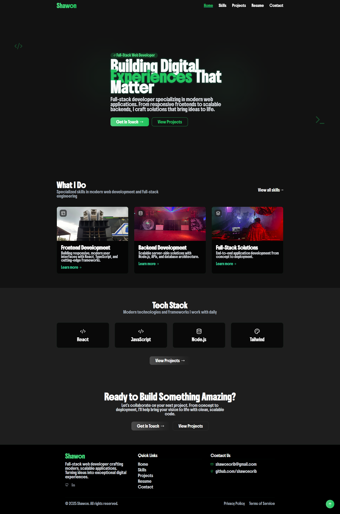

# Portfolio Website

A modern, responsive portfolio website built with React, TypeScript, and Vite, featuring a clean design and smooth animations. This project showcases professional work, skills, and services using modern web technologies.



## 🌟 Features

- **Modern Stack**: Built with React 18, TypeScript, and Vite
- **Responsive Design**: Fully responsive layout with mobile-first approach
- **UI Components**: Leverages shadcn-ui components for consistent design
- **Animations**: Smooth transitions and hover effects
- **Dark Mode**: Built-in dark theme optimized for readability
- **Performance**: Optimized bundle size and load times
- **Type Safety**: Full TypeScript support throughout the codebase

## 🚀 Quick Start

### Prerequisites

- Node.js 18+ and npm installed
- Git for version control

### Installation

```bash
# Clone the repository
git clone https://github.com/shawonorib/shawon-portfolio.git

# Navigate to project directory
cd shawon-portfolio

# Install dependencies
npm install

# Start development server
npm run dev
```

The development server will start at `http://localhost:8080`

## 🛠️ Development

### Available Scripts

```bash
# Start development server
npm run dev

# Build for production
npm run build

# Build for development
npm run build:dev

# Preview production build
npm run preview

# Lint code
npm run lint
```

### Project Structure

```
src/
├── assets/          # Static assets (images, fonts)
├── components/      # Reusable React components
│   ├── ui/         # shadcn UI components
│   └── ...         # Custom components
├── hooks/          # Custom React hooks
├── lib/            # Utilities and helpers
├── pages/          # Page components
└── main.tsx        # Application entry point
```

## ⚙️ Environment variables

This project uses Vite environment variables for runtime configuration. Environment variables must be prefixed with `VITE_` to be available in the client bundle.

Create a `.env` file in the project root (do NOT commit secrets) or set the values in your deployment platform.

Required variables for EmailJS (used by the contact form):

```
VITE_EMAILJS_SERVICE_ID=service_xxx123
VITE_EMAILJS_TEMPLATE_ID=template_abcd1234
VITE_EMAILJS_PUBLIC_KEY=public_key_from_emailjs
```

- After editing `.env` you must rebuild the app for the values to be included in the production bundle:

```bash
npm run build
npm run preview
```

For local development `npm run dev` will pick up `.env` automatically.

There is a `.env.example` in the repository you can copy as a starting point.


### Key Components

- `HeroSection`: Landing page hero component with animations
- `ServiceCard`: Reusable card for displaying services
- `BlogPost`: Blog post display component
- `BookingCalendar`: Calendar component for appointments

### Styling

- Tailwind CSS for utility-first styling
- Custom theme configuration in `tailwind.config.ts`
- Consistent color scheme with custom palette
- Responsive breakpoints at standard sizes

## 🎨 Customization

### Theme

Colors and theme variables can be modified in `tailwind.config.ts`:

```typescript
theme: {
  colors: {
    psyco: {
      green: {
        DEFAULT: '#10B981',
        light: '#34D399',
        dark: '#059669'
      },
      // ...
    }
  }
}
```

### Components

UI components are built on shadcn-ui primitives. Customize them in `src/components/ui/`.

## 📱 Responsive Design

- Mobile-first approach
- Breakpoints:
  - sm: 640px
  - md: 768px
  - lg: 1024px
  - xl: 1280px
  - 2xl: 1536px

## 🔧 Tools and Libraries

- **React Query**: Data fetching and cache management
- **React Router**: Client-side routing
- **Tailwind CSS**: Utility-first styling
- **shadcn-ui**: UI component library
- **EmailJS**: Contact form functionality
- **Lucide Icons**: Modern icon set

## 🚀 Deployment

1. Build the project:
```bash
npm run build
```

2. Deploy the `dist` directory to your hosting provider of choice:
- Vercel
- Netlify
- GitHub Pages
- Any static hosting

## 📦 Dependencies

Core dependencies:
- React & React DOM
- TypeScript
- Vite
- Tailwind CSS
- shadcn-ui components
- React Router
- React Query

Dev dependencies:
- ESLint
- TypeScript ESLint
- Autoprefixer
- PostCSS

## 🤝 Contributing

1. Fork the repository
2. Create your feature branch (`git checkout -b feature/AmazingFeature`)
3. Commit your changes (`git commit -m 'Add some AmazingFeature'`)
4. Push to the branch (`git push origin feature/AmazingFeature`)
5. Open a Pull Request

## 📄 License

This project is licensed under the MIT License - see the [LICENSE](LICENSE) file for details.

## 👨‍💻 Author

Your Name - [shawonorib@email.com](mailto:shawonorib@email.com)

## 🙏 Acknowledgments

- [shadcn-ui](https://ui.shadcn.com) for the excellent UI components
- [Tailwind CSS](https://tailwindcss.com) for the utility-first CSS framework
- [Vite](https://vitejs.dev) for the blazing fast build tool
- [React](https://reactjs.org) for the awesome library

---

Built with care using React, TypeScript, and Vite
